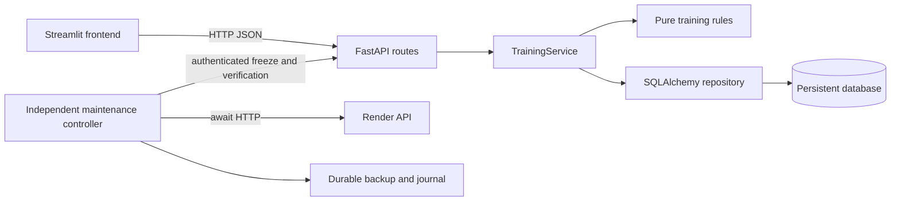

# GymPulse

**A gym training dashboard that turns workout history into an explainable next-session plan.**

Python 3.12 · FastAPI · Streamlit · SQLAlchemy · PostgreSQL / local SQLite

Built for the 2026/2027 Multi-Paradigm Programming Languages practical assignment. This repository includes the application, independent maintenance controller, one shared test suite, CI workflow, sample data and deployment instructions.

> Submission status: local implementation is provided. Real GitHub CI runs, deployment URLs and the real cloud database replacement trial must be completed with the student's accounts. Empty evidence fields below are deliberate, not successful results. See [the requirements checklist](docs/REQUIREMENTS.md).

## What you can do

- Log loaded resistance exercises: date, muscle group, sets, reps, target reps, weight and RPE.
- Explore training history, filter by muscle or exercise, edit incorrect entries, export CSV, or remove an entry.
- Import training history from a CSV with a preview, row validation, atomic saving and exact-duplicate detection.
- See weekly training volume, muscle balance, heaviest working loads and load progression.
- Plan your next session with deterministic recommendations and a reason for every decision.
- Maintain a cloud database through a separately authorized, resumable replacement workflow.

The demo is a shared synthetic workspace, not a multi-user account system. Set an application write token for cloud deployment. The interface stores that token server-side; the maintenance token stays only on the backend and controller computer. Do not store sensitive personal data in this coursework demo.

## Quick start — Windows

Python 3.12.10 is installed on the development computer and `venv` has been created. In VS Code, select `venv\Scripts\python.exe` as the Python interpreter. F5 starts the complete demo using the supplied launch configuration.

For a new installation, install Python 3.12 from [python.org](https://www.python.org/downloads/windows/), then run in PowerShell from the project root:

```powershell
python -m venv venv
.\venv\Scripts\Activate.ps1
python -m pip install -r requirements.txt
Copy-Item .env.example .env
python start.py --demo
```

If PowerShell blocks activation, activation is optional:

```powershell
.\venv\Scripts\python.exe -m pip install -r requirements.txt
.\venv\Scripts\python.exe start.py --demo
```

Open **http://127.0.0.1:8501**. Interactive API documentation: **http://127.0.0.1:8000/docs**.

`--demo` loads 17 synthetic exercise entries only when the database is empty. It never overwrites existing workouts. Without this flag the app starts empty. To initialize data explicitly, run `python -m scripts.seed`. `start.ps1` is another convenience entry point; `project.py` starts the system without seeding by default.

The complete startup script launches the backend, frontend and read-only maintenance scheduler in separate processes. **It never passes replacement authorization.** Press Ctrl+C in its terminal to stop all three. Do not start an additional controller against the same maintenance directory; process locks prevent this.

Separate terminals are also supported:

```powershell
uvicorn backend.main:app --reload
streamlit run frontend/app.py
python -m maintenance.controller
```

SQLite is built into Python; no separate local DB server or backup executable is needed for ordinary development. Application tables are created on backend startup. Data is stored in `runtime/gympulse.db` and survives restarts. The backup implementation is a typed export, so `pg_dump`/`pg_restore` are not required.

## Shareable source package

For an extracted source ZIP on a new Windows computer with Python 3.12 installed, double-click `RUN_ME.cmd`. The standard-library `bootstrap.py` creates a local virtual environment, installs the pinned requirements on first setup and starts the desktop launcher. See `START_HERE.md` for reviewer instructions. No virtual environment, secret settings, private runtime data or actual backup is shipped.

Run `python -m scripts.package_submission` to generate `submission/GymPulse-source.zip`, a single-file source reading copy, a checksum, a links worksheet and an explicitly incomplete email draft. The ZIP supplements the professor's required three live links; it cannot replace deployment, actual CI evidence or the actual authorized replacement trial.

## Desktop application launcher (Windows)

Double-click the **GymPulse** desktop shortcut to start the system without VS Code. It opens a dedicated Edge app window when Edge is installed, otherwise your default browser. A small GymPulse control window manages startup and shutdown. Keep it open while using the dashboard; choose **Stop and close** to stop the components it started. If GymPulse was already running from a terminal, the launcher reuses it and closing the launcher leaves that existing server running.

The shortcut is a local application launcher, not a standalone executable: keep the project folder and its `venv` in place. To recreate the shortcut after moving the folder, run `powershell -ExecutionPolicy Bypass -File scripts/install_desktop.ps1` from the project root. Startup errors appear in the control window, with diagnostics in ignored `runtime/desktop.log`. Desktop startup performs read-only maintenance checks; it never authorizes database replacement.

## Configuration

Copy `.env.example` to `.env` for local settings. The real file, virtual environment, secrets and runtime data are ignored by Git. Configuration is read independently by each component. The frontend can also use Streamlit's secrets management.

| Setting | Meaning |
|---|---|
| `DATABASE_URL` | Backend DB URL; local default `sqlite:///./runtime/gympulse.db`; cloud requires PostgreSQL |
| `API_BASE_URL` | Frontend's own API address; local `http://127.0.0.1:8000` |
| `BACKEND_HOST`, `BACKEND_PORT`, `FRONTEND_PORT` | Local startup bindings, defaults 127.0.0.1 / 8000 / 8501 |
| `APP_WRITE_TOKEN` | Bearer token protecting application writes; optional locally, set in cloud |
| `MAINTENANCE_TOKEN` | Separate bearer secret for all admin endpoints; empty disables admin access |
| `MAINTENANCE_MODE` | Startup write freeze; set programmatically during cloud replacement |
| `CHECK_INTERVAL_SECONDS` | Controller schedule; default 300 seconds, minimum 10 |
| `RENDER_API_KEY` | Render API credential on controller computer only |
| `RENDER_OWNER_ID`, `RENDER_SERVICE_ID`, `RENDER_DATABASE_ID` | Explicit initial workspace, backend and source allowlist |
| `RENDER_REGION`, `RENDER_POSTGRES_VERSION` | Explicit region/major version; samples use frankfurt / 16 |
| `RENDER_CONTROLLER_CIDR` | Controller computer's public IPv4 address as `/32` |
| `MAINTENANCE_DIR` | Durable storage on controller computer; default `runtime/maintenance` |
| `TRIAL_DATABASE_URL` | Empty disposable local PostgreSQL target for the single-free-instance trial restore |
| `TEST_POSTGRES_URL` | Optional dedicated test server; CI provides it automatically |

Generate distinct random tokens locally, for example `python -c "import secrets; print(secrets.token_urlsafe(32))"`. Enter them directly in local/provider secret settings. Never paste actual tokens in a report, commit them, enable SQL echo/wire debugging, or publish raw environment output.

## Architecture and paradigms



The frontend imports no SQLAlchemy/database code. Logging a workout follows the required full data flow: form → `POST /workouts` → `TrainingService.log_workout` → `repository.create_workout` → database commit → JSON response → refreshed UI. Summary/recommendation requests pass stored rows into the pure processing layer.

- **Procedural:** `MaintenanceController.replace` defines an ordered workflow, decomposed into `preflight`, backup, restoration, deployment and verification operations. `seed_demo` is another function-based workflow.
- **Functional:** `recommend`, `latest_recommendations`, `round_load` and `summarize` in `backend/processing.py` have no I/O. Their explicit reference date avoids hidden clock dependence. They leave input records unchanged.
- **Object-oriented:** `TrainingService` coordinates queries, transactions and processing through a session. `GymClient` owns the HTTP boundary, timeout and error translation. `MaintenanceController` encapsulates provider access and durable run recovery. These classes have behavior beyond data modelling.

`backend/main.py` owns HTTP handling, `repository.py` owns queries/write locks, `service.py` coordinates work, and `processing.py` owns the domain calculations. The controller runs outside the backend; importing the API never starts a scheduler or calls Render.

## The training rule

Inputs: the most recent workout for each normalized exercise name, reference calendar date, completed minimum reps across all sets, target reps, load and effort (RPE 1–10).

Output: action, proposed load, elapsed days and a human-readable reason. Apply these conditions **in order**:

| Condition | Action | Proposed load |
|---|---|---|
| Elapsed days < 2 | recover | Same recorded load; wait before repeating |
| Elapsed days ≥ 14 | restart | 90% of last load, rounded |
| RPE ≥ 9 | deload | 90% of last load, rounded |
| Completed reps ≥ target and RPE ≤ 7.5 | increase | Last load + 2.5 kg, rounded |
| Otherwise | hold | Same load |

New/reduced loads round to the nearest total 2.5 kg, halfway up, with a 2.5 kg minimum. For example: 50 kg, 3×8, target 8, RPE 7.5, two days ago → **52.5 kg**; yesterday → **recover**; RPE 9 at two days → **45 kg**. A reference date before the workout is invalid in the single-record rule. Historical aggregate queries ignore later workouts and break same-day ties by highest record ID.

Limits: calendar days are not exact elapsed 48-hour periods. This heuristic doesn't model sleep, technique, injuries, individual equipment increments, or fatigue across different exercises. It covers positive loaded resistance exercises, not bodyweight training. RPE is subjective. Small loads may be rounded substantially. Volume is `sets × minimum completed reps × load`, a conservative estimate when reps vary. Personal records are heaviest logged working loads, not one-rep max predictions. The sample and tests are not medical or personalized coaching evidence.

Data comes from user-entered workouts and the original synthetic `data/demo_workouts.csv`. Its `days_ago` values are converted relative to the initialization date so the demonstration stays relevant. Tests use fixed January 2026 fixtures with explicit expected outputs.

## API

| Method | Route | Purpose |
|---|---|---|
| GET | `/workouts?muscle=Chest&exercise=Bench%20Press` | List/filter persisted workouts |
| POST | `/workouts` | Validate and save a new entry; 201 |
| PUT | `/workouts/{id}` | Replace an entry's editable fields, preserving its ID |
| POST | `/imports/workouts` | Validate and atomically import a CSV; report created/skipped rows |
| GET | `/workouts/{id}` | Retrieve one entry; 404 if missing |
| DELETE | `/workouts/{id}` | Delete an incorrect entry; 204 |
| GET | `/summary?as_of=2026-10-28` | Volume, training days and records |
| GET | `/recommendations?as_of=2026-10-28` | Explainable next-session decisions |
| GET | `/status` | Whether application writes are blocked |
| GET | `/health` | Process health only; not a data-restoration check |
| PUT | `/admin/maintenance` | Authenticated transaction-level write freeze |
| POST | `/admin/write-probe` | Authenticated committed test insert/cleanup while frozen |

POST/PUT/DELETE application writes require `Authorization: Bearer <APP_WRITE_TOKEN>` when configured, including imports. Admin routes always require the separate maintenance token. Framework validation returns 422 for invalid values; missing records return 404; unauthorized access returns 401; foreseeable database failures and frozen writes return 503 without exposing DB credentials. Every request gets a separate SQLAlchemy session, with rollback on errors and closure after the request. HTTP clients use explicit timeouts; provider readiness and deployment polls have bounded deadlines.

### Editing and importing history

In Workout log → Training history, expand **Edit an entry**, choose a record, correct its fields and save. The ID is preserved and subsequent summaries/recommendations use the corrected values. The API accepts a full `WorkoutInput` JSON body with `PUT /workouts/{id}`. Editing respects both the application token and maintenance gate.

In **Import CSV**, download `data/import_template.csv` or upload a previously exported view. Preview the file, confirm import and submit. Required columns are `exercise,muscle,performed_on,sets,reps,target_reps,weight_kg,rpe`; `notes` is optional. Exported `id` is accepted but ignored. New identifiers are generated by the target database. Use UTF-8, comma-separated fields, ISO dates and kilograms. The UI limits files to 2 MB, and the API limits the JSON CSV string to two million characters and 500 records.

The pure `parse_workout_csv` validates every row before any data is written; errors identify the row/field. The repository then locks the write gate, compares normalized full-record identities and inserts all new rows in one transaction. Exact matches in the file or database are skipped, so retrying the same import adds nothing twice. Identity includes every editable field, including notes; changes are distinct records. Intentionally identical sessions should be logged individually rather than imported. Unknown/duplicate headers, invalid values, malformed quotes and oversized row counts are rejected without partial imports.

## Tests and CI

```powershell
python -m pytest
```

All tests are in `tests/`. Rule cases include normal, invalid, boundary and purity checks; expected values are written explicitly. API integration exercises actual FastAPI → processing/service → SQLAlchemy → temporary SQLite file and checks response contents and stored state. Maintenance unit tests simulate provider responses, retry decisions, missing/corrupt backups, full-content restoration and interrupted resource creation. The resume test runs the real controller against simulated provider HTTP and verifies no duplicate create or deletion.

The Streamlit AppTest also fills in the workout form against the real isolated API, saves the entry, renders all four pages and checks unreachable-backend feedback. Dependency versions, including transitives, are constrained by `requirements-lock.txt`. See [actual local verification results](docs/LOCAL_VERIFICATION.md).

CI runs this same command on pushes and pull requests with Python 3.12. It also starts PostgreSQL 16 and runs a restoration/sequence test in generated, disposable schemas. Locally that single PostgreSQL-only test is skipped unless `TEST_POSTGRES_URL` is set. This is an environment prerequisite, not suppression of a failing assertion. Never point it at the deployed system. All ordinary tests use temporary databases and no secrets/live services.

The mandatory failed-then-fixed **GitHub Actions** example is separate from passing local tests. Follow [the evidence instructions](docs/EVIDENCE.md); record both real URLs there before submission. Do not deploy the faulty branch.

## Deploy the actual coursework system

1. Put this project in a GitHub repository. Keep `.env`, `venv` and `runtime` excluded. Review Git's staged file list before pushing.
2. Create a **free Render PostgreSQL 16** instance in Frankfurt in the intended workspace. Record its ID and keep only this application's synthetic data on it. Add the controller computer's public IPv4 `/32` to its external allowlist.
3. Create the Render Python web service using `render.yaml`, or configure build `pip install -r requirements.txt` and start `uvicorn backend.main:app --host 0.0.0.0 --port $PORT`. Supply the DB's **internal** connection URL directly as `DATABASE_URL`; do not use a Blueprint `fromDatabase` reference or an environment group for this setting, because the controller must replace this one service-level value without resetting other settings. Configure distinct app and maintenance tokens. Disable automatic deployments during replacement/CI fault exercises.
4. Initialize synthetic cloud data by running `python -m scripts.seed` locally with `DATABASE_URL` temporarily set to that source's **external TLS** connection URL. Restore local configuration afterwards. This initialization utility does not run automatically on backend deploy, restart or replacement.
5. In **Streamlit Community Cloud**, connect the same repository, select `frontend/app.py` and Python 3.12. Add only `API_BASE_URL = "https://<backend>.onrender.com"` and `APP_WRITE_TOKEN = "<application-write-token>"` to its secret settings. The frontend does not need database credentials or the maintenance token.
6. Add a workout through the cloud frontend. Confirm it appears through the deployed API and survives a backend restart/redeploy. Record the real URLs and results in [EVIDENCE.md](docs/EVIDENCE.md).

Render free web services can sleep, and their filesystems are ephemeral; the cloud database must be external PostgreSQL. Free Render Postgres permits one active instance per workspace and expires after 30 days. The replacement controller below handles the single-instance path with a local trial restore first. Free quotas and account permissions must be checked before each real trial; no automatic paid upgrade is implemented. Keep the apps accessible through the presentation and allow startup time. [Render's free-service limits](https://render.com/docs/free), [Streamlit deployment guide](https://docs.streamlit.io/deploy/streamlit-community-cloud/deploy-your-app).

Cloud application links are **pending account deployment**; fill in `docs/EVIDENCE.md`. This source project alone does not satisfy the mandatory deployment or actual replacement-trial evidence.

## Database maintenance

The controller is designed to run on your Windows computer, independently of the database/backend, while the computer is awake. Backups and journals must be on a durable local drive, not the backend's ephemeral filesystem or the source DB. Keep a second offline copy for your own recovery. No permanent cloud scheduler is required by the brief.

### Read-only checks

Configure the Render API key and resource IDs in your local `.env`, then:

```powershell
python -m maintenance.controller --once
python -m maintenance.controller
```

Each interval uses a real `await httpx.AsyncClient.request` against Render's database status API and logs status/expiry. Missing credentials leave checks disabled with a clear log message. Transient failures are retried up to three times for reads; permission/quota errors stop. An unavailable source or empty table never authorizes replacement. Time comparisons use aware UTC. After success, `active.json` identifies the new monitored instance; the completed run ID is consumed and cannot trigger another replacement.

### Prepare an actual single-free-instance trial

1. Install **PostgreSQL 16** locally using the [official Windows installer](https://www.postgresql.org/download/windows/). Add its `bin` folder to PATH if using `psql`. The Python driver is pinned `psycopg[binary]`; no other backup utility is needed. Use the same major version as Render.
2. Create a dedicated disposable local database, for example using pgAdmin's Create → Database dialog, named `gympulse_restore_trial`. Set `TRIAL_DATABASE_URL=postgresql+psycopg://<local-user>:<local-password>@127.0.0.1:5432/gympulse_restore_trial`. It must contain no application data. Do not use your development or cloud DB as the trial target. Use a new empty trial DB for each new run.
3. Set `MAINTENANCE_TOKEN`, `RENDER_API_KEY`, all source/service/workspace/region/version identifiers, and `RENDER_CONTROLLER_CIDR` in the local `.env`. Check Render permissions and free-instance quotas in the dashboard; the controller also verifies identity/ownership/status, the backend's source address and the available DB inventory through the API. It refuses mismatched resources or non-free plans.
4. Copy `maintenance/authorization.example.json` to a file under ignored `runtime/`. Generate a new UUID using `python -c "import uuid; print(uuid.uuid4())"`. Replace the example IDs, URL, timestamp and CIDR. Review the named resources. Set `permissions_and_quotas_confirmed` and `delete_source_authorized` to true **only after the owner has authorized deletion of that exact source**. The copied sample alone authorizes nothing. Do not share secrets in this file.
5. Stop the startup script's monitor before starting an authorized controller; there may be only one controller per maintenance directory. Stop other jobs that write to this database and avoid manually changing deployments/configuration during the run.
6. Run `python -m maintenance.controller --authorization runtime/approved-run.json`. The schedule triggers at the authorized maintenance time or within seven days of expiry, while the source is accessible. For a due one-off trial use `--once` as well. Preserve logs from this same run as evidence of the actual asynchronous check and full replacement.

### What an authorized run does

1. Verify the exact workspace/backend/source identifiers, permissions/quota confirmation, free plan, region, PostgreSQL version, restricted network access, storage and local trial DB version.
2. Freeze writes through the authenticated backend. Every API write locks one persistent gate row until its transaction ends; freezing takes the same lock, waits for previous writes, then blocks subsequent writes. This also works across API processes. There are no background application writers; explicit initialization respects the same gate. Set service `MAINTENANCE_MODE=true` so redeploys remain frozen.
3. Export every current workout, including user additions, dates, strings, numeric values and IDs. Write a fsynced atomic JSON file with format version, UTC creation time, source ID, reference date, full records, expected domain results and a SHA-256 checksum. No passwords/connection URLs go into the backup or journal. The gate is infrastructure state and is recreated blocked. The application has no table relationships to preserve.
4. Restore into the isolated local PostgreSQL target and compare **every field**, reference-date rule output, and identifier generation. Only after this succeeds and the backup is revalidated may the explicitly named source be deleted. Poll until Render confirms deletion, respecting the single-free-instance quota.
5. Create a separately identified Render database, using the authorized free plan, region, version and controller `/32`. Persist intent before creation and its assigned ID immediately after response. Wait for availability with a deadline; restore through the exact same reusable operation and verify again.
6. Update only the service's `DATABASE_URL` using Render's single-variable endpoint; deploy and await a live deployment. Read the restored records/rule outputs through the API, compare full contents, perform a protected committed write and cleanup, then compare again. Ordinary writes remain frozen throughout.
7. Persist the new active ID and verified status, redeploy with maintenance startup flag false, then explicitly reopen the DB write gate. Save completion. Poll the new ID on future checks.

Render API operations used: [status](https://api-docs.render.com/reference/retrieve-postgres), [list](https://api-docs.render.com/reference/list-postgres), [create](https://api-docs.render.com/reference/create-postgres), [connection information](https://api-docs.render.com/reference/retrieve-postgres-connection-info), [single environment variable](https://api-docs.render.com/reference/update-env-var), [deploy](https://api-docs.render.com/reference/create-deploy). External database connections require TLS; the backend uses the same-region internal address. Never expose the admin token to the browser.

### Recovery after interruption

Do not erase the run journal or generate a new run ID to bypass a failure. Preserve `runtime/maintenance/<run-id>.json`, `<run-id>.backup.json`, `active.json` and `controller.log`. Stop the existing controller and rerun the **same command with the same authorization**.

- Missing/corrupt backup: stop. Restore your independent verified copy; never seed sample data as recovery. The source may only be recaptured while it still exists and remains frozen, under a reviewed recovery procedure.
- Uncertain creation: list provider resources using the recorded unique run name/workspace. Exactly one match is adopted. No match or multiple matches stops with an explicit error; the controller never guesses or sends another create request. Inspect the provider outcome before changing anything.
- Uncertain deployment response: the journal records submission before POST. Inspect Render's deploy history for the recorded service and matching switch/reopen operation; record its actual ID in `deploy_switch` or `deploy_reopen` in the local journal, then resume. Do not invent an ID. Known failed deployments require inspection/fix; after resolving configuration, record the correct replacement deployment ID for the same service before resuming.
- Trial/target contains different data: restoration refuses to erase it. Inspect the exact local trial DB or run-recorded target; any cleanup must be separately scoped to those resources. No global cleanup or automatic truncation is provided.
- Restore or post-switch verification fails: maintenance stays active; preserve the backup/state and correct the cause before resuming. Automatic rollback is not attempted. A deleted old database cannot be recovered by restoring its old connection string.
- Source already unavailable before the normal run: this controller stops. Recovery needs separate owner approval and a previously verified backup. State the backup timestamp and any later potentially lost changes. Without a backup, stop.
- Interrupted after a committed test-write marker: rerun the protected probe; it removes the deterministic marker. Inspect this exact marker only if a read comparison fails before probe cleanup, then resume. Do not remove unrelated workouts.

Only one controller may run against the durable directory, protected by an OS file lock. All creation mutations are single-attempt because a lost response is ambiguous; reads have bounded retries. Safe stopping and manual inspected recovery are intentional limitations.

## Design decisions

1. **Minimum reps rather than recording each set.** A set-by-set relational model would preserve more detail but increase input effort and project scope. One row per exercise session keeps the demo easy to enter and test. Recording the minimum reps allows an honest “all sets met target” decision; accepted cost: volume can be an underestimate and individual set history is lost.
2. **Persistent transaction gate rather than an in-memory flag.** An in-memory flag is easy to implement but cannot drain writes across processes and disappears on restart. Each write holds the same DB gate lock; maintenance then uses both persisted gate state and a provider startup flag through redeployment. Accepted cost: application writes are serialized, appropriate for a small coursework demo rather than a high-traffic system.
3. **Typed export plus verified local trial rather than overlapping free cloud DBs.** Two simultaneous instances would simplify rollback, but Render permits one free DB per workspace. A versioned, checksummed application-level export restores full typed data and sequence generation into local PostgreSQL before deletion. Accepted cost: downtime, a local PostgreSQL prerequisite, and backups limited to this declared application schema. Any schema/rule change requires reviewing the backup version and restore code before future maintenance.

## Sources, AI and extensions

AI tool: OpenAI Codex was used to interpret the brief, generate the initial code, design the UI/tests, and draft documentation. Output is checked through the shared suite and local application smoke checks; the student must review and understand it before submission. Real deployment/trial/CI evidence is recorded separately, not generated as a claim by AI.

The synthetic CSV and UI copy are original to this project. No external workout dataset, scraped material, stock images or copied application code is required. Libraries are the pinned packages in `requirements.txt`; the implementation follows their documented public APIs. Architecture references: [FastAPI testing](https://fastapi.tiangolo.com/tutorial/testing/), [SQLAlchemy sessions](https://docs.sqlalchemy.org/en/20/orm/session_basics.html), [Streamlit docs](https://docs.streamlit.io/), and the linked official Render API docs.

No optional assignment extension is claimed. CSV export, Plotly charts and the normal subprocess startup are part of the application, not evidence of threading, scraping, email or Docker bonuses.

For the presentation use [PRESENTATION.md](docs/PRESENTATION.md). Record real evidence in [EVIDENCE.md](docs/EVIDENCE.md). Submit the repository, Streamlit and Render links at least three days before presentation as specified in the professor's brief; no email is sent automatically.
